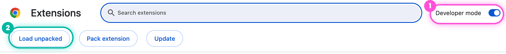

<table>
<tr>
<td width="52%" valign="top">

It's 1 PM on a Sunday and eight games just kicked off. CeeDee Lamb catches a
15-yarder. He's your starter in one league and your opponent's in two others,
and all three score catches differently.

So, good catch or bad catch?

Night Owl tells you the moment it happens, for every play in every league.
It sits in the corner of [sleeper.com](https://sleeper.com) and stays out of the way.

**[⬇ Download Night Owl](https://github.com/Treys21/NightOwl/releases/latest/download/night-owl.zip)**

</td>
<td width="48%" valign="top">

</td>
</tr>
</table>

<table>
<tr>
<td width="25%" valign="top"> <b>Live</b> Every play, with its + or − in each league.</td>
<td width="25%" valign="top"> <b>Lineups</b> Your best lineup before each kickoff.</td>
<td width="25%" valign="top"> <b>Bets</b> Lines and hit rates for your starters.</td>
<td width="25%" valign="top"> <b>Draft</b> Your rankings, live in the draft room.</td>
</tr>
</table>

## Set it up

Takes about two minutes, no tech skills needed. Night Owl isn't in the Chrome Web
Store yet, so you add it to Chrome yourself.

**1. Download** [night-owl.zip](https://github.com/Treys21/NightOwl/releases/latest/download/night-owl.zip)
and open it. On a Mac, double-click it. On Windows, right-click it and choose
**Extract All**. You'll get a folder called `night-owl`.

**2. Open Chrome's extensions page.** Type `chrome://extensions` into the address
bar and press Enter.

**3. Turn on Developer mode** in the top-right corner ①, then click
**Load unpacked** ② and pick the `night-owl` folder.

**4. Add your username.** Click the puzzle piece next to the address bar, pin
Night Owl, then click the owl and type your Sleeper username.

**5. Open [sleeper.com](https://sleeper.com).** Night Owl appears in the corner.

> Keep the `night-owl` folder where it is. Chrome runs Night Owl from it.

**Updating:** download the new zip, unzip it over the old folder, and click the
↻ arrow on Night Owl's card in `chrome://extensions`.

Night Owl runs entirely in your browser: no account, no tracking.
Something not working? [Let me know](https://github.com/Treys21/NightOwl/issues/new/choose).

Made by [Anik Patel](https://github.com/Treys21) · MIT · Not affiliated with Sleeper · [How it works](CONTRIBUTING.md)
