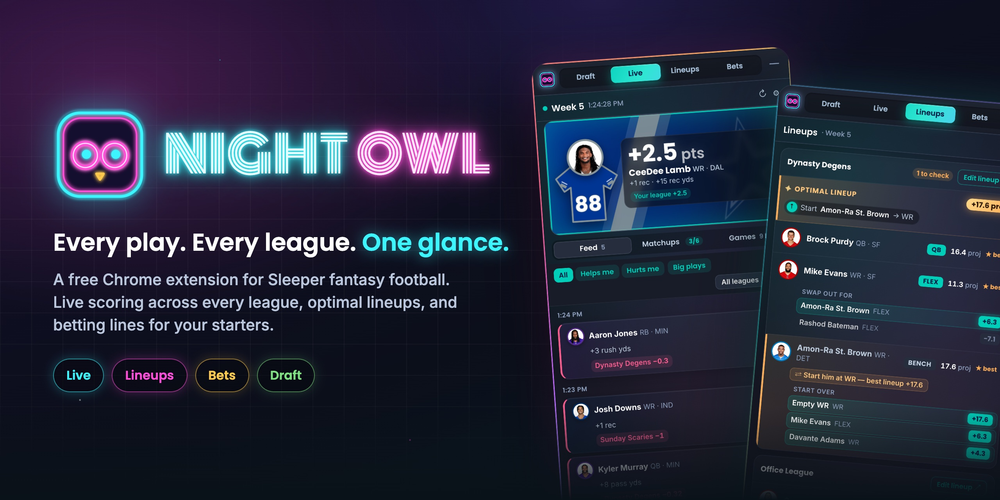
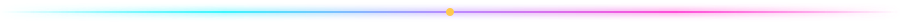

<p align="center">
  
</p>

<p align="center">
  <a href="https://github.com/Treys21/NightOwl/releases/latest"></a>
  <a href="https://github.com/Treys21/NightOwl/actions/workflows/ci.yml"></a>
  
  <a href="LICENSE"></a>
</p>

<p align="center">
  <b>A Chrome extension for <a href="https://sleeper.com">Sleeper</a> fantasy football.</b><br>
  Live scoring across every league you play in, optimal lineups before each kickoff,<br>
  betting lines for your starters, and your own big board on draft day.
</p>

<p align="center">
  <a href="#install"><b>Install</b></a> ·
  <a href="#features"><b>Features</b></a> ·
  <a href="#privacy"><b>Privacy</b></a> ·
  <a href="https://github.com/Treys21/NightOwl/issues/new/choose"><b>Feedback</b></a>
</p>

<p align="center"></p>

<table align="center">
  <tr>
    <td align="center" width="25%"><br><b>Live</b><br><sub>Every play, scored per league</sub></td>
    <td align="center" width="25%"><br><b>Lineups</b><br><sub>Optimal lineup before kickoff</sub></td>
    <td align="center" width="25%"><br><b>Bets</b><br><sub>Lines and odds for your starters</sub></td>
    <td align="center" width="25%"><br><b>Draft</b><br><sub>Your rankings, live in the draft room</sub></td>
  </tr>
</table>

<p align="center"></p>

## Install

Night Owl is distributed as a release package while it is in testing.

1. Download **`night-owl-v<version>.zip`** from the [latest release](https://github.com/Treys21/NightOwl/releases/latest) and unzip it.
2. Open `chrome://extensions` and enable **Developer mode**.
3. Select **Load unpacked** and choose the unzipped folder.
4. Click the Night Owl icon in the toolbar, enter your **Sleeper username**, and select **Save**.
5. Open [sleeper.com](https://sleeper.com). The panel appears in the corner of the page.

Night Owl runs in Chrome 116 or later and other Chromium browsers, including Edge, Brave and Arc. To update, unzip the new release over the old folder, then select **↻** on the extension card and reload sleeper.com.

## Features


**Live.** A single game-day feed for every league. Each scoring play by your starters or your opponents' starters appears once, with its effect in each league under that league's scoring settings: `+` when it helps you, `−` when it hurts. Big plays land on the stage in team colors. Filter by league, by plays that help or hurt, or by big plays only.

**Lineups.** Your roster grouped by kickoff window, starting with the next one to lock. An exact solver finds the optimal lineup, including flex and superflex chains, and lists every valid swap with its projected gain. Starters who are on bye, out, or in an empty slot are flagged before kickoff.

**Bets.** Sleeper Picks lines and DraftKings milestones for each player you start, shown in American odds, with hit rates over the last ten games, projection against the line, and matchup context. Once a game starts, each line shows live progress. For information only; no wagers are placed.

**Draft.** Your rankings as a big board inside Sleeper mock and league drafts: who is gone, who took them, how far each pick landed from your rank, and an alert when you are on the clock. Rankings sync from The Ringer or can be edited by hand.

<br clear="right">

<p align="center"></p>

## Privacy

Night Owl runs entirely in your browser. It has no account, server, analytics or tracking. It stores your Sleeper username, rankings, panel layout and data caches in Chrome's local extension storage, and it only reads public data.

| Permission | Purpose |
| --- | --- |
| `storage`, `unlimitedStorage` | Settings, rankings and caches. Sleeper's player directory is about 5 MB. |
| `sleeper.com` | Displays the panel on Sleeper pages. |
| `api.sleeper.app`, `api.sleeper.com` | Leagues, rosters, matchups, players, live stats, projections and Sleeper Picks lines. |
| `site.api.espn.com`, `sports.core.api.espn.com` | Kickoff times, game odds and DraftKings player props. |
| `theringer.com` | Draft rankings sync. |

## Data sources

Night Owl reads the same public data feeds that power Sleeper's and ESPN's own sites. These feeds are not published APIs, so a change on the provider's side can interrupt a feature. Each feature depends only on its own feeds and falls back where it can, for example to Sleeper's schedule when ESPN is unavailable. If a feed stops responding, the panel names it and keeps retrying, while everything else continues to work.

## Development

Night Owl is plain Manifest V3 JavaScript with no build step and no runtime dependencies.

```bash
npm ci            # development tools
npm run verify    # lint, static checks and unit tests
npm run package   # dist/night-owl-v<version>.zip
```

Load the repository folder with **Load unpacked** while developing. See [CONTRIBUTING.md](CONTRIBUTING.md) for the architecture, conventions and release process, and [CHANGELOG.md](CHANGELOG.md) for release history.

## License

[MIT](LICENSE) © 2026 Anik Patel. Night Owl is an independent project and is not affiliated with or endorsed by Sleeper, ESPN, DraftKings or The Ringer. Their names and data belong to their respective owners.
