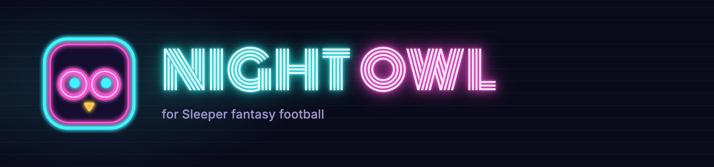
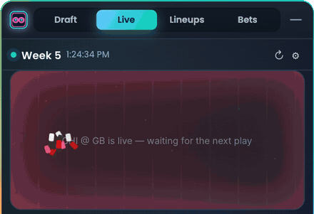
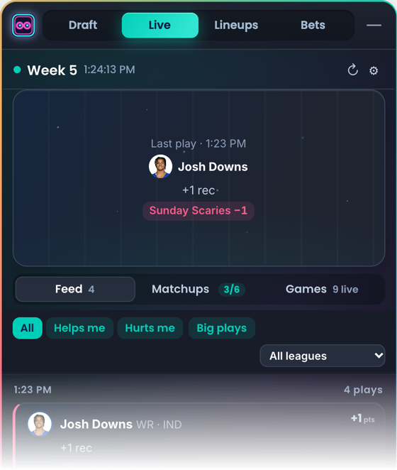
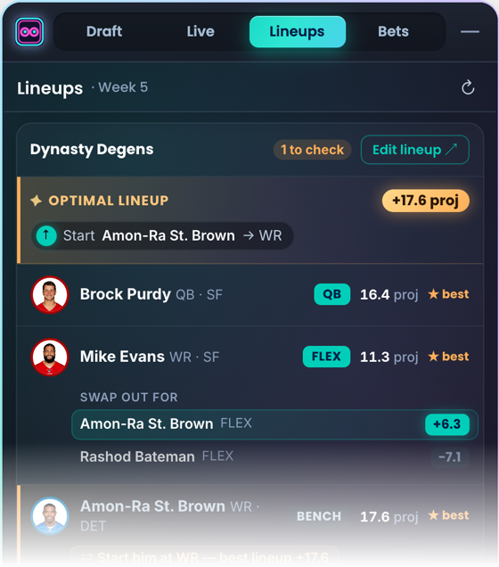
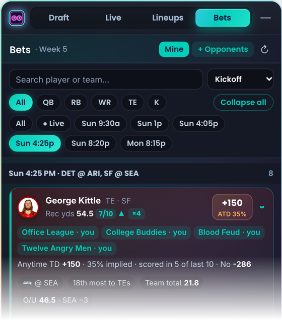
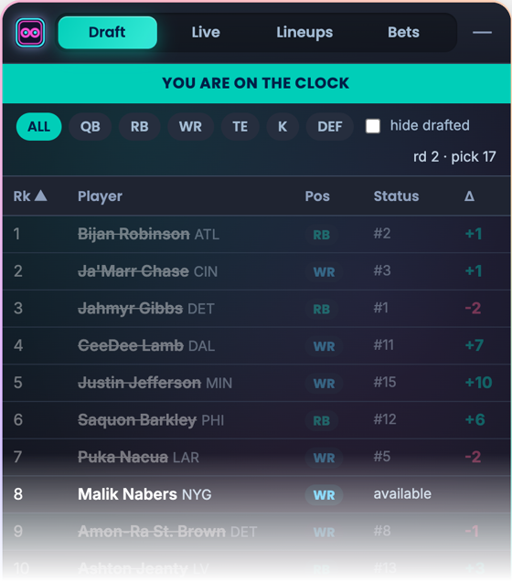

Night Owl is a Chrome extension that adds a small panel to [sleeper.com](https://sleeper.com).
It's built for people in more than one league.

I play in several Sleeper leagues, and every one of them scores differently. On
Sundays I kept flipping between matchups to work out whether a CeeDee Lamb catch
was good news or bad. He'd be my starter in one league and my opponent's in two
others, and half PPR in one but full PPR in another. Night Owl does that math for
every play, in every league, as it happens.



## What it does

There are four tabs. Only the one you're looking at runs.



**Live** lists every scoring play by your starters and your opponents' starters,
newest first. Each play shows what it was worth in each league, from your side:
**+** if it's your player, **−** if it's theirs. It never adds the leagues together,
because they're separate games. When eight games kick off at 1 PM it gets busy, so
you can filter to one league, to plays that help or hurt you, or to big plays only.
Matchups and per-game views are one tap away.

Points come from each league's own scoring settings and match Sleeper's totals.
There's a test for that against real matchups.

<br clear="right">



**Lineups** goes through the week by kickoff window, next lock first. For each
league it works out the best possible lineup, flex spots included, and tells you
the exact moves. It also flags anyone on bye, ruled out, or sitting in an empty
slot. It can't change your lineup for you, since Sleeper's API is read-only, so
each league gets an **Edit lineup** link.

<br clear="right">



**Bets** puts Sleeper Picks lines and DraftKings milestones next to each player you
start, with how often he's cleared each line in his last ten games and how his
projection compares. Once his game starts, the lines fill in live. It's there to
look at; nothing is ever placed.

<br clear="right">



**Draft** is a big board for draft day. Load rankings from The Ringer or type your
own, and in a Sleeper draft room it shows who's gone, who took them, how far each
pick landed from your rank, and when you're on the clock.

<br clear="right">

## Installing

It isn't on the Chrome Web Store yet, so for now it installs by hand. It takes
about two minutes.

1. Download `night-owl-v<version>.zip` from the [latest release](https://github.com/Treys21/NightOwl/releases/latest) and unzip it.
2. Go to `chrome://extensions` and turn on **Developer mode** (top right).
3. Click **Load unpacked** and pick the unzipped folder.
4. Click the owl in your toolbar, type your Sleeper username, and hit **Save**.
5. Open sleeper.com.

It works in Chrome 116 or newer, and in Edge, Brave and Arc. To update, unzip the
new version over the old folder, click ↻ on Night Owl's card, and refresh Sleeper.

If something looks off, or you have an idea, [open an issue](https://github.com/Treys21/NightOwl/issues/new/choose).
A screenshot helps a lot.

## Privacy

Everything runs in your browser. There's no account, no server, and no analytics.
Night Owl saves your username, rankings and a few caches in Chrome's local
storage, and it only reads public data:

- **Sleeper** for leagues, rosters, matchups, live stats, projections and Picks lines
- **ESPN** for kickoff times, game odds and DraftKings props
- **The Ringer** for draft rankings, only when you click Sync

## When something breaks

None of those feeds are official APIs. They're what Sleeper's and ESPN's own sites
use, so they can change without warning. Each tab only depends on the feeds it
needs, and when a feed stops answering, the panel tells you which one instead of
going quiet. If that happens on a Sunday, an issue gets it fixed fastest.

## Working on it

It's plain JavaScript with no build step. You'll need Node 20+ to run the checks.

```bash
npm ci
npm run verify    # lint, static checks, tests
npm run package   # builds the release zip
```

Load the repo folder with **Load unpacked** while you work. [CONTRIBUTING.md](CONTRIBUTING.md)
covers how it's put together, and [CHANGELOG.md](CHANGELOG.md) has the history.

---

Made by [Anik Patel](https://github.com/Treys21). MIT licensed. Not affiliated
with Sleeper, ESPN, DraftKings or The Ringer.
